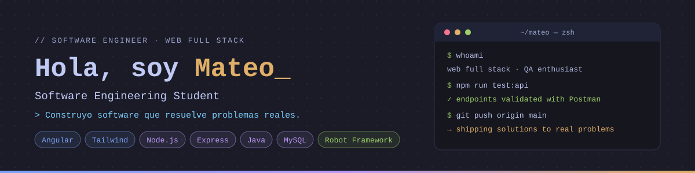

  

<h3 align="center">
  Estudiante de Ingeniería de Software · Desarrollador Web y Aplicaciones · Entusiasta de la Arquitectura de Software 
</h3>

  

---

##  Sobre mí

Soy estudiante de **Ingeniería de Software** y **desarrollador Web y Aplicaciones** apasionado por construir aplicaciones web robustas, escalables y bien diseñadas. Aplicar buenas prácticas de **arquitectura de software** y garantizar la calidad del producto mediante **testing y automatización de pruebas**. Disfruto llevar una idea desde el diseño de la interfaz hasta la lógica del servidor y la base de datos.

-  **Enfoque:** Desarrollo Web (Frontend & Backend), Arquitectura de Software 
-  **Calidad:** Pruebas automatizadas con Robot Framework y Selenium
-  **Idiomas:** Español (Nativo) · Inglés (B1)
-  **Actualmente:** Aprendiendo y mejorando mi código 

---

##  Stack Tecnológico

###  Frontend

  
  
  
  
  

###  Backend & Bases de Datos

  
  
  
  
  

###  Herramientas & Testing

  
  
  
  

---

##  Estadísticas de GitHub

  
  &nbsp;
  

  

---

##  Proyectos Destacados

###  [Nexos]([https://github.com/MateoLMR/nexos](https://mateolmr.github.io/nexos/#/))
Plataforma web interactiva para la **comunidad gamer**. Reúne artículos e información sobre videojuegos, un **foro de discusión interactivo** y una sección dedicada a las **noticias de eSports**.

>  **Repositorio:** [github.com/MateoLMR/nexos](https://github.com/MateoLMR/nexos)

###  [DAI — Digitalización y Almacenamiento de Información]([https://github.com/gabriel-guevara/D.A.I](https://gabriel-guevara.github.io/D.A.I/login))
Sistema de **gestión documental** y plataforma empresarial orientada a la **digitalización de archivos físicos**, ideal para firmas de abogados y empresas con alto flujo documental. Ofrece **control de versiones**, **trabajo colaborativo** y una **biblioteca digital** para organizar la información de forma eficiente.

>  **Repositorio:** [github.com/gabriel-guevara/D.A.I](https://github.com/gabriel-guevara/D.A.I)

---

##  Contacto

  
  

  

  
  ¡Gracias por visitar mi perfil!
  

